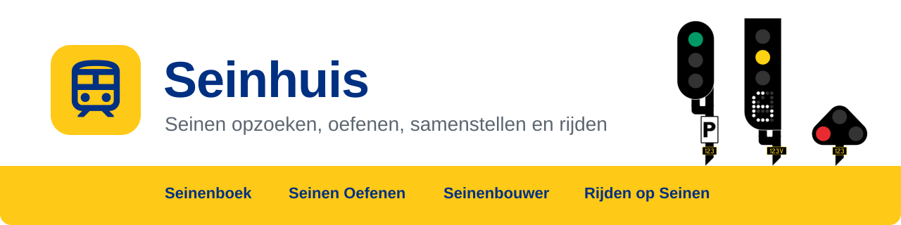

  

  <a href="https://jamieluik.github.io/seinhuis/"><b>Open Seinhuis&nbsp;→</b></a>

---

**Seinhuis** is een webpagina om de seinen langs het Nederlandse spoor op te zoeken, te leren, zelf samen te stellen en ermee te oefenen op een gesimuleerde rit. Alles staat in één pagina: je hebt geen account of app nodig, en het werkt op de computer en op de telefoon.

## Seinenboek

Alle seinen per sectie, met plaatje, omschrijving, betekenis en toelichting.

- **Zoeken** op seinnummer, omschrijving, betekenis of toelichting.
- **Inhoudsopgave** om snel naar een sectie te springen.
- Per sein een **kaart** met de kernpunten en een link naar de wettekst.

## Seinen Oefenen

Kies de secties die je wilt leren en daarna hoe je wilt oefenen:

| Modus | Wat je doet |
| --- | --- |
| **Doornemen** | Steeds een willekeurige kaart, met plaatje, betekenis en toelichting. |
| **Multiple choice** | Bij het plaatje de juiste betekenis kiezen uit vier antwoorden. |
| **Flashcards** | Zelf de betekenis invullen en daarna aanvinken welke kernpunten je had. |

Na multiple choice en flashcards krijg je een verslag als PDF. In het Seinenboek kun je de **resultaten van de vorige oefenronde** bij de seinen laten zien.

## Seinenbouwer

Stel stap voor stap een sein samen: plaatsing, soort sein, kleur, knipperen, cijferbak, P-sein en seinnummerbord. Je kunt zelf het nummer op het bord invullen. Combinaties die niet bestaan staan grijs, met uitleg waarom. Je ziet meteen welk sein uit het Seinenboek erbij hoort, en je kunt het resultaat **exporteren als PNG**.

## Rijden op Seinen Oefenen

Oefen het rijden op seinen met een zelfgemaakte rit (op een tablet of computer).

- **Missiegenerator:** maak een route met stations, seinen, snelheidsborden en seinbeelden, eventueel met gedoofde of onjuiste seinen. Met de **missiecode** deel je een rit of rijd je hem opnieuw.
- **Seinen langs de route** met hectometerborden, kenborden en de snelheid bij elk sein; **exporteer de missie als PDF**.
- **Start oefening:** rijd de missie sein voor sein en kies binnen vijf seconden wat je doet: afremmen, versnellen, stoppen, rijden op zicht of **de treindienstleider bellen**, inclusief de **European Instruction (EI1)**.
- Na afloop een **overzicht** met je antwoorden, tijden en uitleg bij fouten, ook als PDF.

## Verder

- **Dag- en nachtstand** die vanzelf meewisselt met zonsopkomst en zonsondergang. Je kunt ook zelf wisselen.
- **Changelog** met zoekfunctie, onderaan de pagina.

---

  Seinhuis © 2026 Jamie Luik · Toelichting © 2023 NS

